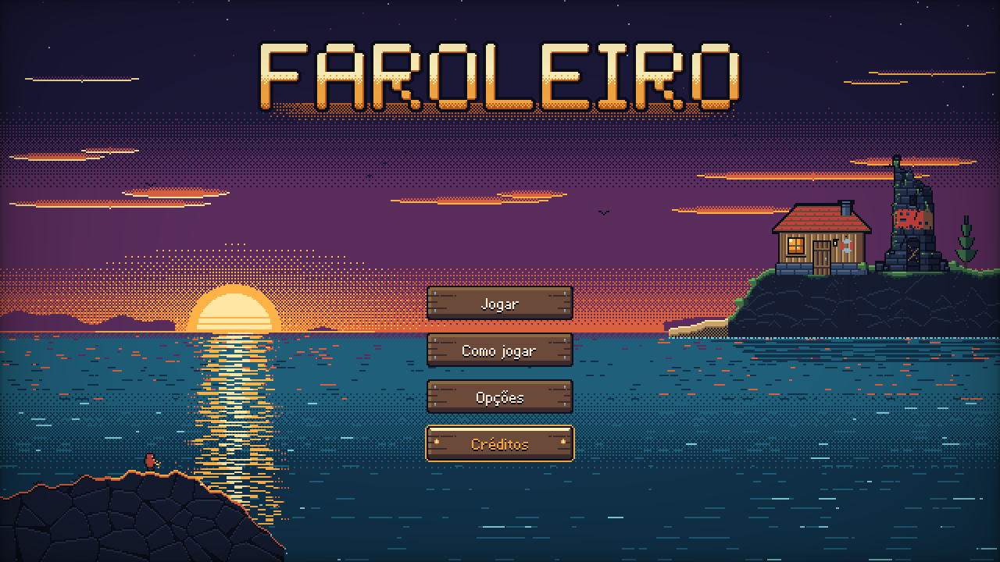
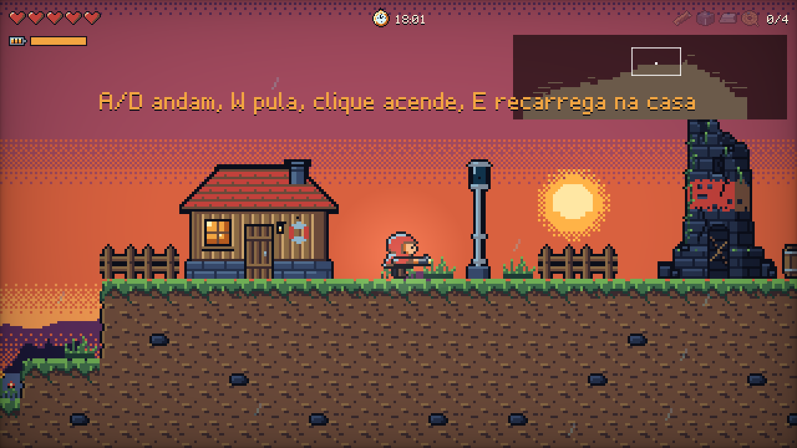
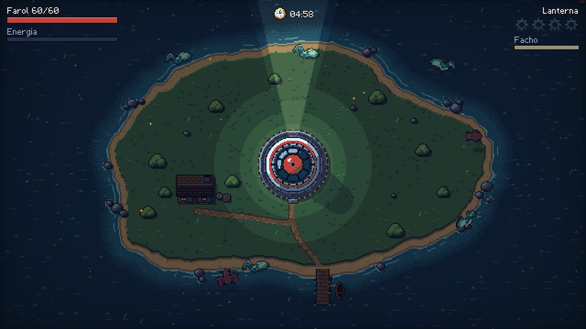
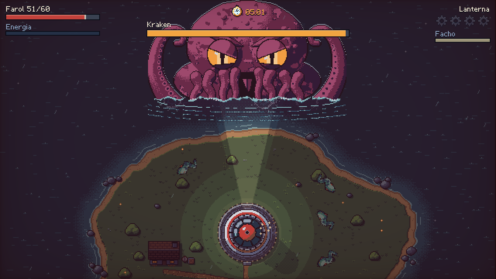

# O Faroleiro

Jogo 2D em pixel art feito com MelonJS para o trabalho de Jogos Digitais. O jogador é o faroleiro de uma ilha e tem uma noite inteira, das 18h às 6h, para consertar o farol.

**Jogue agora no navegador: https://vegga-ceo.github.io/MelonJS/**



## Descrição geral

### Enredo

O farol da ilha quebrou e a noite caiu. O faroleiro precisa juntar as peças da torre antes que o escuro tome a ilha. Quando a torre está de pé, ele fica dentro do farol e usa o facho de luz para defender a ilha até o amanhecer.

### Objetivos

A partida dura cerca de 15 minutos e tem duas fases. Cada uma termina com um chefe.

- **Fase 1, a ilha (18h às 0h).** Plataforma vista de lado. O jogador anda pela ilha com uma lanterna que dá dano nos monstros e tem bateria limitada, que ele recarrega na porta da casa. Às 19h, 20h, 21h e 22h aparece uma peça da torre na praia, e os mini-chefes derrubam baús com melhorias. Às 23h o Holandês Voador surge no mar, e o jogador precisa apagar as três lanternas verdes do navio para vencer.
- **Fase 2, o farol (0h às 6h).** Visão de cima. O jogador aponta o facho do farol com o mouse e dispara contra morcegos, piranhas e serpentes, e a energia dos monstros derrotados rende melhorias. Às 5h o Kraken sobe do mar, e o jogador precisa acertar os olhos dele, passar pelas aberturas dos anéis e traçar os tentáculos com o mouse.

O jogador vence quando o sol nasce com o Kraken derrotado. Perde se os corações acabarem, se o Holandês escapar às 0h, se a torre ficar sem vida ou se der 6h com o Kraken vivo.







### Controles

| Fase | Controle | Ação |
|---|---|---|
| 1 | A e D (ou as setas) | andar |
| 1 | W, seta para cima ou Espaço | pular |
| 1 | S ou seta para baixo | descer de um andaime |
| 1 | Mouse | mirar a lanterna |
| 1 | Botão esquerdo | acender a lanterna |
| 1 | E na porta da casa | recarregar a bateria |
| 2 | Mouse | apontar o facho |
| 2 | Botão esquerdo ou Espaço | disparar a luz |
| 1 e 2 | 1, 2 e 3 | escolher uma carta de melhoria |
| 1 e 2 | Esc | pausar |

## Ferramentas utilizadas

- [MelonJS](https://melonjs.org/) 20.12, o motor do jogo.
- [Vite](https://vite.dev/) 8, que serve o jogo no desenvolvimento e gera o build.
- JavaScript com módulos ES.
- Mapas no formato JSON do [Tiled](https://www.mapeditor.org/) (`.tmj`), gerados por scripts.
- Os efeitos sonoros são sintetizados por código com WebAudio, sem arquivos de áudio. A trilha sonora é gravada: duas músicas originais feitas para o jogo, em `public/data/audio/`. A música sintetizada toca só na pausa e nas telas de vitória e derrota.
- A arte em pixel art é desenhada por scripts em `tools/`.

## Versão jogável

O jogo roda direto no navegador, sem instalar nada, pelo GitHub Pages: **https://vegga-ceo.github.io/MelonJS/**. A página é publicada de novo a cada mudança na `main`.

Para ter uma versão executável local, sem servidor de desenvolvimento, rode `npm ci` e `npm run build`. A pasta `dist/` é o jogo pronto: sirva-a com `npm run preview` ou publique em qualquer hospedagem de arquivos estáticos.

## Instalação e execução

Pré-requisito: [Node.js](https://nodejs.org/) 20.19 ou mais recente (ou 22.12 ou mais recente) e o npm que vem com ele.

```bash
git clone https://github.com/Vegga-CEO/MelonJS.git
cd MelonJS
npm ci
npm run dev
```

O `npm run dev` mostra um endereço no terminal, normalmente `http://localhost:5173`. Abra-o no navegador e clique em **Jogar**.

Outros comandos:

| Comando | O que faz |
|---|---|
| `npm run build` | gera o jogo para publicação na pasta `dist/` |
| `npm run preview` | serve o conteúdo de `dist/` para conferir o build |
| `npm run arte` | gera de novo toda a arte do jogo (tileset, mapas, sprites, fonte e título) |

Para testar sem esperar a partida inteira, abra o jogo com `?debug` no fim do endereço (por exemplo, `http://localhost:5173/?debug`). As teclas 0 a 6 pulam horas, trocam de fase e forçam a vitória ou a derrota.

## Equipe

| Integrante | Parte do jogo |
|---|---|
| Pedro | base, gestão do repositório, interface e música do menu e da Fase 1 |
| Caio | Fase 1 |
| Bernardo | Fase 2 |
| Rafael | arte, som e música da Fase 2 |
